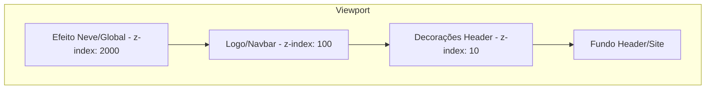

# Plano de Correção: Decorações Sazonais e Responsividade

Este plano visa corrigir o corte de decorações sazonais em dispositivos móveis e ajustar a hierarquia de camadas (z-index) para garantir que a logo e a neve animada sejam exibidas corretamente.

## 1. Análise Técnica

### Causas Identificadas
- **Corte no Mobile:** O contêiner `.tema-faixa-decorativa` e suas imagens possuem estilos que não se adaptam totalmente à largura do celular, ou dependem de escalas fixas que extrapolam a viewport.
- **Sobreposição da Logo:** A hierarquia de `z-index` atual está dispersa. A logo não possui um `z-index` explicitamente superior às decorações sazonais (`.tema-decoracoes-header` tem `z-index: 1090`, enquanto a navbar pode estar no mesmo nível ou inferior).

### Hierarquia de Z-Index Proposta
1.  **Neve Animada (`.tema-efeito_neve`):** Camada Superior (dentro de `.tema-decoracoes` com `z-index: 1026` fixo, mas precisamos garantir que nada no header a cubra indevidamente se quisermos que caia na frente de tudo). *Nota: O `.tema-decoracoes` atual é `fixed` com `z-index: 1026`, enquanto o header tem `z-index: 1090`. Isso faz com que a neve fique ATRÁS do header.*
2.  **Logo (`.navbar-brand-logo`):** Superior às decorações.
3.  **Controles Navbar:** Visíveis e clicáveis.
4.  **Decorações Sazonais (`.tema-faixa-decorativa`, `.tema-decoracoes-header`):** Atrás do conteúdo.
5.  **Fundo do Header.**

---

## 2. Passos para Implementação

### Passo 1: Ajuste na Hierarquia de Camadas (z-index)
Alterar [`public/assets/css/site/temas.css`](public/assets/css/site/temas.css):
- Redefinir `z-index` de `.tema-decoracoes` (global) para ser a camada mais alta (ex: `2000`) para garantir que a neve caia sobre a logo.
- Ajustar `.tema-decoracoes-header` para um valor menor (ex: `10`) e garantir que `.navbar-brand-logo` e `.navbar-toggler` tenham um `z-index` maior que as decorações do header (ex: `20`).
- Garantir que a `navbar` tenha `position: relative` (ou similar) para respeitar o stacking context.

### Passo 2: Responsividade das Decorações
Alterar [`public/assets/css/site/temas.css`](public/assets/css/site/temas.css):
- No media query `max-width: 991.98px`:
    - Ajustar `.tema-faixa-decorativa` e `.tema-decoracao_superior` para usar `max-width: 100%`.
    - Garantir `height: auto` e `object-fit: contain` para evitar distorção.
    - Se a decoração for uma imagem horizontal única, aplicar `width: 100%` e `height: auto` para que ela encolha proporcionalmente à tela do celular.

### Passo 3: Refinamento do Header
Ajustar [`views/components/site/navbar.php`](views/components/site/navbar.php):
- Adicionar classes ou estilos inline (se necessário, preferencialmente no CSS) para garantir que a logo (`.navbar-brand-logo`) crie um novo stacking context superior.

---

## 3. Diagrama de Camadas (Visual)

## 4. Verificação e Validação
- [ ] Verificar overflow horizontal em 320px, 375px, 430px.
- [ ] Confirmar que a logo não é coberta pelas guirlandas/luzes.
- [ ] Confirmar que a neve cai na frente da logo.
- [ ] Testar em diferentes temas (Natal, etc.).

---
**Você concorda com este plano? Posso prosseguir para a fase de implementação no modo Code?**
